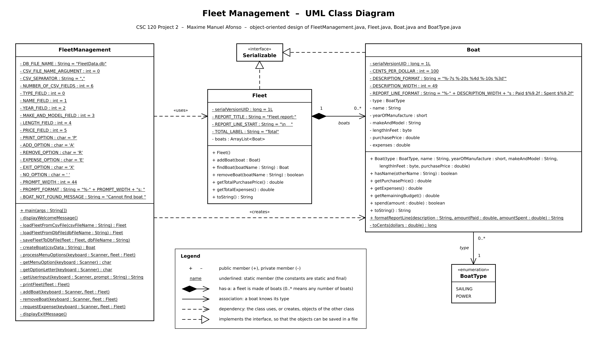

# Fleet Management System

CSC 120 - Project 2 - Maxime Manuel Afonso

A Java program for the Commodore of the Coconut Grove Sailing Club. It tracks what the boats of the
club cost to buy and to maintain, and applies the Commodore's policy: the club may not spend more on
a boat than it cost to buy the boat.

## Contents

| Folder or file | What it is |
| --- | --- |
| `src/FleetManagement.java` | Main class: the menu, the keyboard input and all the file handling |
| `src/Fleet.java` | The fleet: an `ArrayList` of boats |
| `src/Boat.java` | One boat, with the Commodore's policy |
| `src/BoatType.java` | The type of a boat: `SAILING` or `POWER` |
| `design/FleetManagement_Analysis.txt` | Object-oriented analysis |
| `design/FleetManagement_Design.txt` | Object-oriented design |
| `design/FleetManagement_ClassDiagram.jpg` | UML class diagram |
| `javadoc/index.html` | JavaDoc web pages |
| `FleetData.csv` | The fleet data for the initialising run |

## Running the program

There are two ways to run the main class `FleetManagement`:

| Run | Command line parameter | Where the fleet comes from |
| --- | --- | --- |
| Initialising run | `FleetData.csv` | The CSV file named on the command line |
| Normal run | none | `FleetData.db`, in which the program saves the fleet when it exits |

In IntelliJ these are two run configurations of `FleetManagement`: one with the program argument
`FleetData.csv`, and one with no program argument. `FleetData.csv` is in the project folder, which is
the working directory of both configurations, and `FleetData.db` is created there.

## Class diagram

